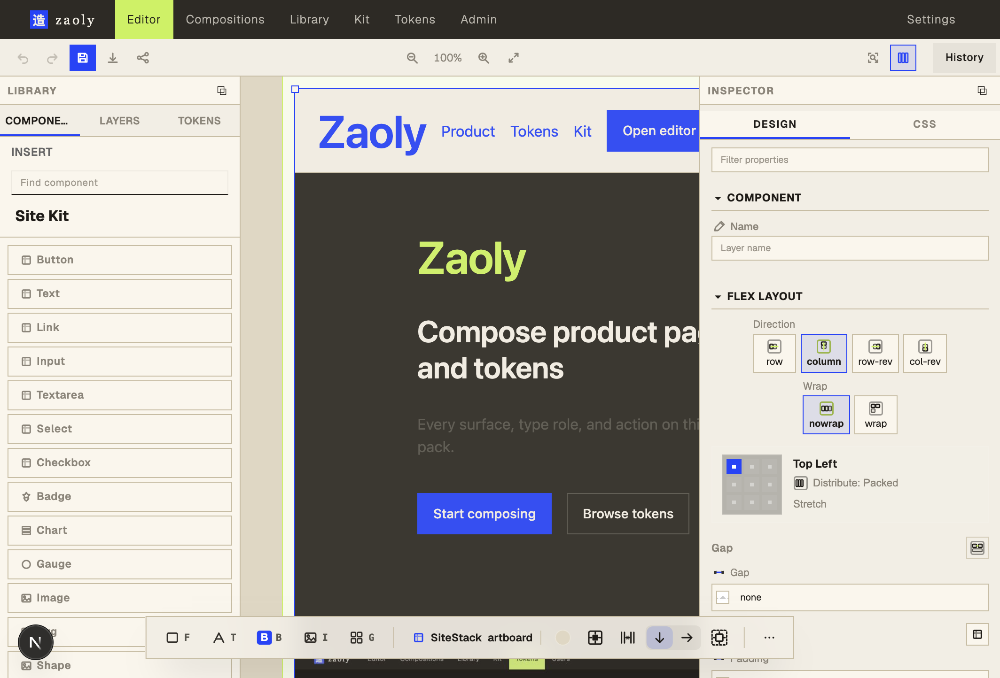
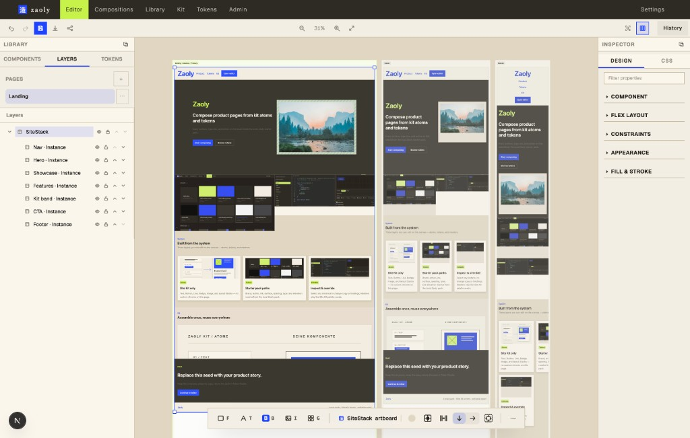
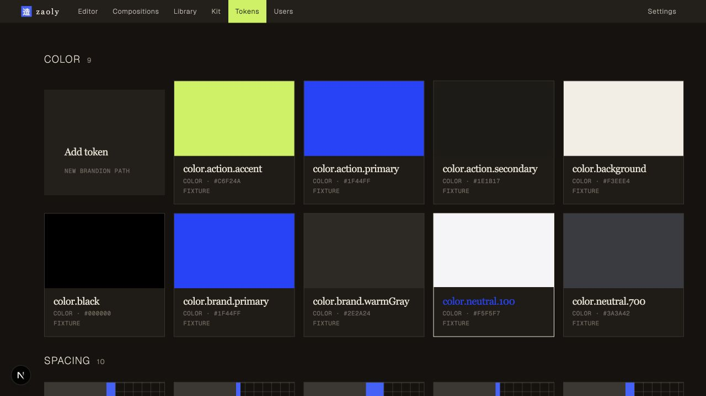
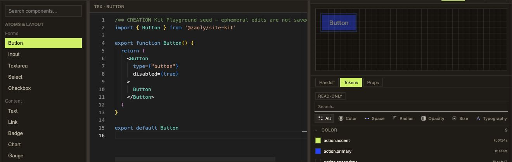

# Zaoly

**From design to real components.**

Zaoly is an open-source **enterprise web design** editor: compose responsive pages on a canvas, structure them with a Site Kit and masters, bind brand tokens, and hand off real React — not throwaway mockups.

Try the hosted product at [zaoly.app](https://zaoly.app), or clone this repo to develop and self-host (AGPL).

**Latest release:** [`v0.1.1`](https://github.com/aurovylabs/zaoly-delivery/releases/tag/v0.1.1) · Image: `ghcr.io/aurovylabs/zaoly-delivery:0.1.1`

<p align="center">
  
</p>
<p align="center"><em>Editor — canvas, Site Kit, and inspector</em></p>

---

## Why Zaoly

Most design tools stop at pictures. Zaoly keeps designers on a real composition scene that already speaks the language of product UI:

- **Canvas-first editing** with pages, layers, artboards, and desktop / tablet / mobile breakpoints
- **Site Kit atoms** (Button, Text, Input, Card, layout…) you can compose and promote into masters
- **Masters, instances, and named variants** so structure stays shared while expression changes
- **Local Token Studio** for color, type, space, and more — bind tokens in the editor instead of hard-coded values
- **Kit Playground** to try atoms with live TSX + preview
- **React / code handoff** with preview and accessibility preflight — for teams that ship to other React apps
- **Accounts & starter scenes** — each new user gets a personal default landing composition (Postgres)

Print / magazine PDF production and suite federation are intentionally out of scope. Zaoly is web-design first.

---

## Features

| Area | What you get |
|------|----------------|
| **Editor** | Immersive `/editor` — undo/redo, pan/zoom, selection, inspect, smart HUD, autosave |
| **Responsive** | Digital artboards · breakpoint cascade · **multi-breakpoint compare** (desktop / tablet / mobile) |
| **System** | Scene-local masters · Site Kit palette · variants · starter landing sections |
| **Tokens** | Local pack at `/tokens` · bind paths on components · CSS / JSON export |
| **Kit** | Playground at `/kit` · catalog atoms · patterns when a Collection is bound |
| **Handoff** | Surface PNG/PDF · HTML preview · code export · React module orientation |
| **Collab** | Comments · presence · named versions · scene members / client share |
| **Ops (self-host)** | Local users · public signup · platform admin · SMTP · audit · MFA / passkeys |

<p align="center">
  
</p>
<p align="center"><em>Multi-breakpoint — desktop, tablet, and mobile side by side</em></p>

<p align="center">
  
</p>
<p align="center"><em>Token Studio — local brand pack (demo data)</em></p>

<p align="center">
  
</p>
<p align="center"><em>Kit Playground — atoms, TSX, and live preview side by side</em></p>

---

## Quick start (local)

Requires Node 22+ (see root `package.json` engines if present).

```bash
git clone https://github.com/aurovylabs/zaoly-delivery.git
cd zaoly-delivery
npm install
npm run dev
```

Open [http://localhost:3009/editor](http://localhost:3009/editor).

JSON / lightweight auth works for solo DX. For multi-user Postgres:

```bash
docker compose up -d
# configure ZAOLY_DATABASE_URL + AUTH_SECRET in apps/web/.env.local
npm run bootstrap:local-pg   # when available
```

---

## Self-host (Docker)

```bash
cp deploy/.env.example deploy/.env
# Required: AUTH_SECRET, ZAOLY_POSTGRES_PASSWORD, ZAOLY_DATABASE_URL,
# ZAOLY_BOOTSTRAP_ADMIN_EMAIL / ZAOLY_BOOTSTRAP_ADMIN_PASSWORD,
# NEXT_PUBLIC_ZAOLY_URL, AUTH_URL
docker compose -f deploy/docker-compose.self-host.yml --env-file deploy/.env up -d --build
```

Bootstrap admin is whatever you set in `.env` — there is **no** seeded `admin@zaoly.app` in this pack.

Public signup defaults **on** when Postgres is configured (`ZAOLY_PUBLIC_SIGNUP=0` to disable). Each new member gets a **personal** starter landing scene; Site Kit edits stay scene-local until you explicitly publish (Collection fork).

### Prebuilt image (GHCR)

Tagged releases publish `ghcr.io/aurovylabs/zaoly-delivery`:

```bash
docker pull ghcr.io/aurovylabs/zaoly-delivery:0.1.1
# or
docker pull ghcr.io/aurovylabs/zaoly-delivery:latest
```

See [Releases](https://github.com/aurovylabs/zaoly-delivery/releases) and [CHANGELOG.md](CHANGELOG.md).

---

## Repo layout

| Path | Role |
|------|------|
| `apps/web` | Next.js app — editor, hubs, APIs |
| `packages/ui` | `@zaoly/ui` design system |
| `packages/site-kit` | Site Kit atoms & compositions |
| `packages/contracts` | Shared scene / op shapes |
| `mcp-server` | Optional MCP tools (`zaoly.*`) |
| `specs/` | Domain & API specs (source of truth for behavior) |
| `deploy/` | Self-host Compose + `.env.example` |

---

## License

[AGPL-3.0-only](LICENSE). If you run a modified version as a network service, you must offer corresponding source (AGPL §13).

---

## Hosted product

Prefer managed hosting? Use [zaoly.app](https://zaoly.app). This repository is the developable source: bring your own `.env`, Postgres, and deploy target. Product contracts live under `specs/`.

Questions or enterprise interest: [hey@zaoly.app](mailto:hey@zaoly.app)
