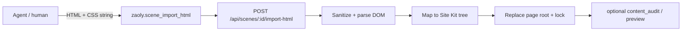

# HTML → Scene import (agent first-draft)

**Status:** Shipped P1 + P1.5 layout + **P2-A/B/C fidelity** + **P2 Select/Input/Badge** + **P2.1 header paint** — 2026-08-26  

**Depends:** `composition-scene.md` · `scene-pages.md` · `scene-agent-editing.md` · `site-kit.md` · `editor-inspect.md` · `html-scene-import` API · **`html-scene-import-p2-fidelity.md`**  
**API:** `specs/api/scene-html-import.md`  
**MCP:** `zaoly.scene_import_html` (maps to API)  
**Plexon:** `assistant-creation-mcp.md` § HTML first-draft  
**Knowledge:** `knowledge/html-scene-import.md`

## Purpose

Agents (and humans) generate a **single marketing/landing HTML document** (inline CSS allowed) the way they would ship a static web page. CREATION **deterministically converts** that HTML into a Site Kit `SceneNode` tree on a scene page — with **literal** colors/spacing in `props` (no Brandion token invent). Ops polish / Inspect remain the refinement path.

This complements (does not replace) `scene_apply_ops`. Micro-ops remain for edits; **greenfield pages** SHOULD prefer import over dozens of insert rounds.

## Why (problem)

The multi-round `insert_child` / `set_prop` loop is slow, hangs mid-stream, and leaves Site Kit fixture chrome. LLMs are strong at HTML/CSS in one shot. Preview already goes **Scene → HTML**; this track adds **HTML → Scene**.

## Non-goals (v1)

- Arbitrary React/JSX, hooks, bundlers, or npm imports.
- 100% round-trip fidelity with `scene-preview` HTML (lossy map is OK; document warnings).
- Absolute positioning / CSS Grid full fidelity / animations / media queries as first-class nodes.
- Auto-creating Brandion tokens from Hex.
- Blind `PUT` whole-scene replacement (import writes via validated tree replace on **one page root** + optimistic lock).
- Penpot/Figma pipelines.

## Architecture



### Single source of truth after import

| Layer | SoT |
|-------|-----|
| Persisted layout | `CompositionScene` page root (`SceneNode` tree) |
| Visual chrome | `props` literals (+ optional later `set_token_binding`) |
| Further edits | `applySceneOp` / editor Inspect |

## Input contract (agent-facing)

```ts
type SceneHtmlImportRequest = {
  baseUpdatedAt: string
  html: string // full document or body fragment; max size server-enforced
  pageName?: string // if set → add_page then import into new page
  pageId?: string // else replace this page root; default activePageId
  mode?: 'replace-page-root' // v1 only
}
```

### Agent HTML constraints (v1 — MUST document in MCP description)

WENN der Agent HTML für Import erzeugt, DANN MUSS er:

1. Semantische Sections (`header`/`main`/`section`/`footer` oder `div` + Klassen) und **Flex-Stacks** bevorzugen — horizontale Nav/Stats/CTA-Zeilen mit `display:flex; flex-direction:row; gap:…`.
2. Farben/Abstände als **inline `style`** oder einfache **`.class { … }` / `body` / `:root`-Regeln** in `<style>` (Hex, `px`/`rem`); Klassen werden mit Inline gemerged (Inline gewinnt). **Page-Background** auf `body` oder `:root` setzen (nicht nur innere Sections).
3. Texte in echten Textknoten (`h1`–`h3`, `p`, `a`, `button`, `label`, `span`) belassen. **Metriken/Logos als ein Textknoten** (`3+`, `360°`, `Zaoly`) — nicht Zahl und Suffix/Wörter in getrennte Elemente splitten.
4. Bilder als `img` mit `alt` (+ optional `src`).
5. Kein `<script>`, kein `iframe`, kein externes Stylesheet laden (nur Inline / `<style>` im Dokument).
6. Eine **Viewport-breite** Landing (~desktop); Mobile-Feinschliff später im Editor.

## Mapping rules (deterministic)

### Element → Site Kit type

| HTML | Scene type | Notes |
|------|------------|--------|
| `body` / root wrapper | `SiteStack` | column; page shell |
| `section`, `header`, `footer`, `main`, `nav`, `div` (block) | `SiteStack` | direction: resolved `flex-direction`; if `display:flex` without direction → **row**; `nav`/`header` with ≥2 children → row; class names matching `nav|row|stats|metrics|…` → row |
| flex row container | `SiteStack` | `direction: row` |
| `display:grid` | `SiteGrid` | `columns` from `grid-template-columns` repeat count or child count (cap 6) |
| `h1`–`h3` | `SiteText` | `role`: display/title |
| `p`, `span` (block-ish) | `SiteText` | `role`: body |
| `button`, `a.button`, `[role=button]` | `SiteButton` | `props.children` = label |
| `a` (else) | `SiteLink` | `href` + children |
| `img` | `SiteImage` | `src`, `alt`; width/height → `set_style` numbers when parseable |
| `svg` | **`SiteSvg`** | Sanitized outer markup → `props.markup`; `viewBox` / `aria-label` / `<title>` → alt/title; width/height attrs → style (`specs/domain/site-svg.md` Phase 0) |
| `input` (text/email/…/checkbox/radio/file) | `SiteInput` | `placeholder`, `name`, `type`, `value`/`defaultValue`, `disabled` + surface literals |
| `input[type=hidden]` | — | omit (not left in flow) |
| `input[type=submit\|button\|reset]` | `SiteButton` | label = `value` (fallback `Submit`) |
| `textarea` | `SiteTextarea` | `placeholder`, `name`, `rows`, `value`/`defaultValue`, `disabled` |
| `select` | `SiteSelect` | `options` newline list (`value\|label` when different); selected → `defaultValue` |
| `hr` | `SiteDivider` | |
| badge-like small pill | `SiteBadge` | Heuristik: Tag `span`/`p`/`div`/`em`/`strong`; nur Text/Inline; Länge 1–28; Klasse `badge\|pill\|chip\|tag` **oder** (`border-radius` + background) |

Unknown tags → `SiteStack` wrapper + children; never drop text.

### Style → props / style (literals)

Styles resolve from **`<style>` rules** for simple `.foo`, tag selectors (`h1`–`h6`, `p`, `a`, …), one-level descendants (`.intro h2`, `.brand span`, `.intro h2 em`), narrow adjacent siblings (`.day + .day`, `.planning article + article`), and `body` / `:root` / `html`, merged with inline `style` on the element (inline wins). Pseudo-classes (`:hover`) and deeper compounds remain unmapped.

**Desktop-first:** `@media` / `@keyframes` / `@supports` blocks are **stripped** before rule parse so mobile overrides cannot collapse grids / hide seals on the artboard.

**Namespaced keys:** `.nav` and element `nav` MUST NOT share a map key (footer `nav { flex-direction:column }` must not clobber header `.nav { display:grid }`).

**Structural `<a>`:** Anchors with block children (story cards) map as containers (SiteStack/SiteGrid), not a single flattened SiteLink label.

**`font` shorthand:** Expand to `font-size` / `font-family` / `font-weight` / `line-height` when those longhands are absent (so `h1 { font: 400 clamp(4rem,10vw,11rem)/.72 Georgia,serif }` survives import).

**`display:grid`:** Multi-column `grid-template-columns` → `SiteGrid`. Rows-only grids (`grid-template-rows` without columns) → **column `SiteStack`** (not a fake 2-col grid from child count).

**Skip / off-screen chrome:** `.skip` / `sr-only` / fixed+`translateY(-…)` MUST be omitted (not left in flow).

**`var(--*)` resolution:** Custom properties on `:root` / `html` / `body` are collected at import; `var(--name)` / `var(--name, fallback)` in mapped styles MUST expand to concrete values before writing `props` (so Inspect/preview never keep unresolved `var(--ink)`). Prefer agent HTML that already uses Hex/rem/px literals — var resolution is a safety net, not the craft path.

| CSS | Scene |
|-----|--------|
| `background` / `background-color` | `props.background` Hex/rgb string; **no** token bind |
| `color` | `props.color` |
| `border-color` | `props.borderColor` |
| `border` / `border-top` / `border-right` / `border-bottom` / `border-left` (shorthand) | `style.border*` CSS strings (`currentColor` → inherited `color`) |
| `border-*-width` / `border-*-style` / `border-*-color` (longhands) | combined into matching `style.border*` when no side shorthand |
| `border-radius` | `props.radius` (px/rem string) |
| `gap`, `padding*` | `props.gap` / `padding*` literals |
| `font-size` / `font-weight` / `font-family` / `line-height` | typography props literals |
| `letter-spacing` / `text-transform` / `text-decoration` / `text-align` | `props.letterSpacing` / `textTransform` / `textDecoration` / `textAlign` |
| `margin` / `margin-*` | `props.margin*` literals |
| `justify-content` / `align-items` / `align-self` / `align-content` | `props.justify` / `align` / `alignSelf` / `alignContent` (flex aliases normalized) |
| `overflow` | `props.overflow` |
| `opacity` | `props.opacity` (0–1) |
| `min-width` / `max-width` / `min-height` / `max-height` | `props.minWidth` etc. literals |
| `width` / `height` | `style.width` / `style.height` — px number when parseable, else CSS string |
| `aspect-ratio` / `font-style` | `style.aspectRatio` / `style.fontStyle` |
| `place-items: center` (and flex/grid align center) | Stack/Grid `props.align` + `props.justify` = `center` (seal/mark) |
| `background-image` / gradient in `background` | `props.gradient` (Inspect fill) |
| `grid-column` / `grid-row` | `node.style.gridColumn` / `gridRow` |
| `.host::before` / `::after` | decorative `SiteStack` child (`::before` first, `::after` last) | host `position: relative` on `node.style` |
| `display:none` / `hidden` | omit node or `flags.hidden` if supported |

**Inherited paint (header / cream-on-wine):** For `SiteText` / `SiteLink` / `SiteButton` / `SiteBadge`, missing `color` / `font-family` / `font-size` / `font-weight` / `letter-spacing` / `text-transform` / `line-height` MUST be filled from ancestor resolved styles before writing props (so `.hero { color }` and `.brand { font }` reach leaf nodes). Loose text under a styled parent (e.g. `.brand`) MUST use the parent’s resolved style, not `{}`.

**Mark / seal surfaces:** A `span`/`div` with circle-like paint (`border-radius: 50%` + width/aspect-ratio + border) or class `seal|mark|avatar` MUST map to a centered `SiteStack` wrapping a `SiteText` child — not a flattened `SiteText` alone.

P2 fidelity waves (detail + EARS): **`specs/domain/html-scene-import-p2-fidelity.md`**.

Adjacent inline phrase siblings (`span`/`strong`/…) without whitespace MUST join with a space when coalesced into one `SiteText` (avoids `Waswirmitbringen`).

Default Site Kit `tokenBindings` on insert MUST **not** be applied for imported nodes (or MUST be cleared) so literals win and Inspect shows Hex, not fixture token labels.

### IDs / names

- Generate stable unique `id`s (`imp-<slug>-<n>`).
- `name` from tag + truncated text or `aria-label` / `data-name`.

## Persist semantics

1. Auth = scene ops (session or service + actor).
2. Optimistic lock via `baseUpdatedAt`.
3. If `pageName`: run equivalent of `add_page` then import into new active page.
4. Replace **only** that page’s root tree (and page frame if needed); other pages untouched.
5. Return `{ scene, pageId, warnings[], stats }`.
6. Persist the raw import `html` on the target `ScenePage` as `importSourceHtml` (+ `importSourceHtmlAt`) for editor HTML preview.
7. Persist a **Craft Debug Bundle** on the same page as `craftDebug` (+ `craftDebugAt`) — see `craft-debug.md` (scene stats, craft-thin flags, optional `craftMeta.spirion`).
8. On parse/sanitize failure: `400` with stable `code` (`html-too-large`, `html-unsafe`, `html-empty`, `html-map-failed`).

## Warnings (lossy map)

Converter MUST collect human+machine warnings, e.g.:

- `ignored-absolute-position`
- `ignored-media-query`
- `collapsed-grid-to-stack`
- `dropped-pseudo`
- `truncated-text`

Agents MUST surface non-empty `warnings` in the user reply and MAY fix via ops.

## Agent loop (Plexon, when shipped)

1. (Optional) Spirion inspiration — structure/copy only.
2. Emit **one** HTML document (tool arg or prior message).
3. `creation_scene_import_html` once.
4. `creation_scene_content_audit` → fix via ops if needed.
5. `creation_scene_preview` → Vision polish via ops (max 2).
6. Do **not** rebuild the page with micro-inserts after a successful import unless the user asks.

## EARS

- WENN ein Caller `POST …/import-html` mit gültigem HTML und passendem `baseUpdatedAt` sendet, DANN MUSS der Server die Ziel-Page-Root durch einen Site-Kit-Tree ersetzen und `200` + Scene liefern.
- WENN HTML Scripts/iframes enthält, DANN MUSS der Server sie strippen oder mit `html-unsafe` ablehnen (v1: strip + warn).
- WENN der Agent eine neue Landing/PDP **greenfield** baut und `scene_import_html` verfügbar ist, DANN SOLL er Import statt ≥N insert-Runden nutzen.
- WENN Mapping lossy ist, DANN MUSS `warnings[]` nicht leer sein für ignorierte Absolute/Media-Queries.
- WENN ein Text-/Link-Leaf keine eigene `color` trägt, aber ein Vorfahr (z. B. `.hero`) schon, DANN MUSS der Mapper `props.color` vom Vorfahren setzen (SiteLink Accent-Default überstimmen).
- WENN ein Mark/Seal (`border-radius:50%` + Breite/Aspect + Border, oder Klasse `seal`) nur Text enthält, DANN MUSS der Mapper einen zentrierten `SiteStack` mit `SiteText`-Kind erzeugen.

## Phased delivery

| Phase | Scope |
|-------|--------|
| **P0 Spec** | This doc + API + MCP row (no runtime) — done |
| **P1 Converter** | Stack/Text/Button/Link/Image/Divider + inline color/gap; replace page root; `pageName` → add_page; API + MCP — **shipped** |
| **P1.5 Layout** | `<style>` class rules; flex default row; nav/header/stats heuristics; `display:grid` → `SiteGrid` — **shipped** |
| **P2-A Fidelity** | Contract props: typo micro, margin, flex align, overflow, opacity, dims, borders — **shipped** (`html-scene-import-p2-fidelity.md` Wave A) |
| **P2-B Fidelity** | Gradients, `.class span|em`, sibling rules, grid placement, colored/block inline headlines — **shipped** (Wave B) |
| **P2-C Fidelity** | `::before`/`::after` → decorative SiteStack children — **shipped** (Wave C) |
| **P2** | Select/Input/Badge (+ Textarea; submit→Button; hidden omit) — **shipped** |
| **P2.1 Header paint** | Inherited color/typo on leaves; seal→centered Stack; brand loose-text style — **shipped** |
| **P3** | Plexon depth prompt prefers import for greenfield — **shipped (light)** |

## Acceptance (when implementing)

1. Unit: HTML fixtures → expected Site Kit subtree (snapshots).
2. Contract: API shapes in `@zaoly/contracts` if exported.
3. MCP tool proxies HTTP; inventory lists tool.
4. Specs inventory lists this file + API.
5. Staging smoke: Urban Glide HTML import → audit ok → preview without multi-minute ops hang.
