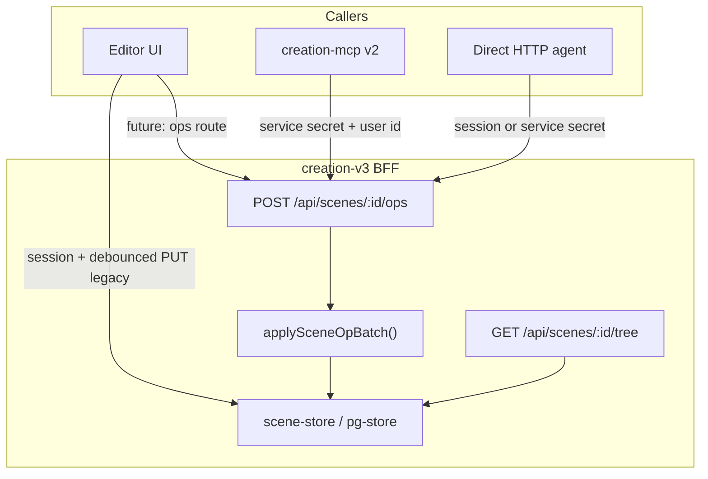

# Scene agent editing — CREATION v3

**Status:** Accepted (shipped P90) — 2026-08-23 · hardened 2026-09-09  
**Depends:** `composition-scene.md` · `composition-masters.md` · `scene-pages.md` · `scene-board.md` · `editor-inspect.md` · `brand-token-consume.md` · `plexon-federation.md`  
**API:** `specs/api/scene-ops.md` · `specs/api/scenes.md`  
**MCP:** `specs/domain/mcp-server.md` § v2 write surface  
**Knowledge:** `knowledge/scene-agent-editing.md`  
**Contracts:** `@zaoly/contracts` (`SceneOp`, `SceneOpResult`, `CompositionScene`)

## Purpose

Expose the **same validate-before-write mutation model** the in-browser editor uses (`applySceneOp` in `apps/web/lib/scene/ops.ts`) as a **first-class HTTP + MCP surface** so Plexon assistants, Cursor agents, and other machine callers can build and refine composition layouts **without** replacing the scene document via coarse `PUT`.

The editor UI remains the primary human surface. Agent editing MUST NOT invent a parallel scene model, a second op vocabulary, or guessed partial writes.

## Goals

1. **Op parity:** Every persisted `SceneOp` accepted by the editor MUST be applicable server-side with identical validation semantics (`composition-scene.md` ops table + lock rules).
2. **Determinism:** Invalid ops MUST be rejected with a stable machine reason — never auto-corrected or partially applied inside a batch.
3. **Concurrency safety:** Concurrent human + agent writers MUST detect lost updates via `updatedAt` optimistic locking.
4. **Federation-ready auth:** Browser sessions AND Plexon service-secret callers (MCP) MUST be supported with explicit actor attribution for audit.
5. **Agent ergonomics:** Lightweight tree index + palette catalog reads MUST exist so agents can plan ops without loading full scene JSON on every turn.
6. **Page artboards:** Agents MUST be able to create and switch pages via the same ops as the editor (`add_page`, `set_active_page`, …) through MCP `zaoly.scene_apply_ops` — see `scene-pages.md`. New-page intents (PDP, Pricing, Contact, …) MUST NOT be satisfied by inserting only into the current page when the user asked for a separate page.

## Non-goals (P90)

- Real-time collaborative editing (OT/CRDT) — optimistic lock only.
- Server-side undo/redo stacks — client editor keeps local history; agent batches are atomic commits.
- Exposing raw `PUT` replacement as the recommended agent path (remains escape hatch only).
- Zaoly FS / CEM bridge writes.
- Penpot / Figma import pipelines.
- Auto-layout inference (“make this look like Apple.com”) without explicit ops.
- `select` persistence — UI-only op stays client-local.
- Site Kit composition save as part of the core op batch (separate MCP tool maps `POST /api/site-kit/compositions`).

## Architecture



### Single source of truth

| Layer | SoT |
|-------|-----|
| Op vocabulary | `@zaoly/contracts` `SceneOp` |
| Validation + mutation | `apps/web/lib/scene/ops.ts` (`applySceneOp`) |
| Persisted document | `CompositionScene` via `scene-store` / Postgres |
| Inspect / token grammar | `editor-inspect.md` + Brandion active pack |

Server implementation MUST call the **same** `applySceneOp` implementation the editor uses (extract to shared module if route handler cannot import app code directly).

## Mutation batch semantics

### Batch shape

Agents send an ordered `ops: SceneOp[]` array. The server:

1. Loads current scene by id (404 if missing).
2. Verifies optimistic lock (`baseUpdatedAt` — see API spec).
3. For each op in order: `applySceneOp(working, op)`.
4. On first failure: abort entire batch; return `409`/`400` with `failedIndex` + `reason`; **no partial persist**.
5. On full success: prune comments per existing save rules, bump `updatedAt`, persist once, return full `scene` + `appliedCount`.

### Rejected server-side ops

| Op | Server |
|----|--------|
| `select` | MUST reject (`op-not-persisted`) — selection is editor chrome only (`scenes.md` persistence fields). |
| All others in `SceneOp` | MUST be supported when listed in `composition-scene.md` ops table at ship time. |

### Limits

| Limit | Value | Error code |
|-------|-------|------------|
| Max ops per batch | 64 | `batch-too-large` |
| Max scene nodes (post-apply) | 2000 | `tree-too-large` |
| Max masters | 256 | `masters-too-large` |
| Max pages | 64 | `pages-too-large` |
| Request body | 2 MiB | `payload-too-large` |

Limits MUST match or be stricter than editor practical bounds; document changes in both this file and `scene-ops.md`.

## Optimistic concurrency

- Every successful persist updates `scene.updatedAt` (ISO-8601 UTC).
- Mutating routes REQUIRE `baseUpdatedAt` in the request body matching the loaded scene’s `updatedAt` exactly.
- Mismatch → `409` `stale-scene` with `{ scene: { id, updatedAt } }` snapshot header/body so the caller can refresh and retry.
- `PUT /api/scenes/:id` MUST adopt the same `baseUpdatedAt` requirement in P90 follow-up (breaking for agents relying on blind PUT — document in migration note).

## Authorization model

WENN Auth konfiguriert ist (`ZAOLY_FEDERATION_AUTH_URL` + `ZAOLY_SERVICE_SECRET`), DANN gilt:

### Session callers (browser, user cookie)

- Same gate as existing `/api/scenes*` (`requireApiSession()`).
- MAY read/write any scene the session can `GET`.

### Service callers (MCP, automation)

- MUST present valid service headers (`X-Service-Secret`, `X-Federation-Contract-Version`) per `federation-contract.ts`.
- MUST present `X-Actor-User-Id` (non-empty) — the human or service account the automation acts for.
- MUST NOT bypass collection binding rules: when scene has `platformProjectId`, caller MUST be entitled to that Collection in Plexon (same ACL as session callers via `require-scene-collection-access`). Unreachable federation / empty accessible set → `403 { "error": "forbidden" }` (fail closed). Unbound scenes remain allowed for authenticated service actors.

WENN Auth nicht konfiguriert (local dev), DANN routes bleiben offen wie heute.

Defense in depth: middleware + route handler + store-level id check.

## Agent read surfaces

### Full scene — existing

`GET /api/scenes/:id` — unchanged. Agents use for small scenes or after batch failure recovery.

### Tree index — new

`GET /api/scenes/:id/tree` — compact navigational index (see `scene-ops.md`). MUST NOT duplicate full `props` / `tokenBindings`; agents fetch details via targeted `GET` or prior context.

### Palette catalog — new

`GET /api/editor/palette` — insertable types, default child seeds policy, `seedProps` / `contentHint`, container rules. Backed by `EDITOR_PALETTE_*` + `defaultChildForType` metadata export (no free-CSS types).

### Content-complete inserts

WENN `insert_child` angewendet wird, DANN MUSS der Server den Child-Baum mit `defaultChildForType` mergen (`seedInsertChildTree`) — gleiche Seeds wie Palette-Drag. Agents SOLLEN trotzdem echte Labels/Options/Placeholders in `props` setzen (Defaults sind Fallback, kein fertiges Layout).

WENN `insert_instance` für seitenspezifischen Inhalt genutzt wird, DANN MUSS der Agent `props` am Op setzen (oder im selben Batch `set_prop` auf die Instance) — nackte Instances behalten Master-Seed-Copy („Get started“, „Option A“, „Text“).

Marketing-/PDP-Seiten: **Site Kit** bevorzugen; für Copy/CTAs/Selects **`insert_child` mit Props** ist oft klarer als Palette-Instances ohne Overrides.

### Content audit (Welle 1 self-check)

`GET /api/scenes/:id/content-audit` · MCP `zaoly.scene_content_audit` — see `scene-content-audit.md`. Agents MUST run this before finishing PDP/landing builds and fix `error` findings.

### Craft debug (Welle 1.5 density)

`GET /api/scenes/:id/craft-debug` · MCP `zaoly.scene_craft_debug` — see `craft-debug.md`. Agents MUST read `craftFlags` / `sceneStats` after import (or before finish) and fix `craft-thin` before claiming done.

### Scene preview (Welle 2 pixel self-check)

`GET|POST /api/scenes/:id/preview` · MCP `zaoly.scene_preview` — see `scene-preview.md`. After audit ok, agents MUST request a WebP and Vision-check (max 2 preview rounds).

### HTML first-draft import (Proposed)

`POST /api/scenes/:id/import-html` · MCP `zaoly.scene_import_html` — see `html-scene-import.md`. Greenfield landings SHOULD prefer one HTML import over multi-round inserts. Ops remain for polish.

### Freies Styling vs Brand tokens

- **Literale (first-class, no token create):** same as Inspector — `set_prop` on surface keys (`background`, `color`, `borderColor`, `gap`, `radius`, `fontSize`, …) with Hex/rem/px; `clear_token_binding` when replacing a bound key. Paint: props override token resolve (`resolveNodePaintStyle`). See `knowledge/editor-inspect-literals.md` § Agent free paint.
- **Token bind (optional):** `set_token_binding` after `GET /api/brand-tokens?platformProjectId=` when the Collection pack should drive the surface.
- `set_style` remains **width/height numbers only**.

### Brand tokens — existing

`GET /api/brand-tokens?platformProjectId=` — before `set_token_binding` ops (not required for literal `set_prop` styling).

## Error model (domain)

All failed applies return structured JSON:

```ts
type SceneOpErrorBody = {
  error: string          // stable code
  message: string        // human-readable
  failedIndex?: number   // batch index
  op?: SceneOp           // echo failed op when safe
  reason?: string        // from SceneOpResult.reason
  scene?: { id: string; updatedAt: string } // on stale-scene
}
```

Stable codes MUST be listed in `scene-ops.md` and covered by contract tests.

## Relationship to Site Kit export

Agent layout editing targets **`CompositionScene`** (editor model: `Stack`, `SiteStack` palette types, Masters, Instances).

Publishing to Storybook remains **`POST /api/site-kit/compositions`** after the scene (or a Master subtree) is valid. MCP tool `zaoly.site_kit_composition_save` wraps that route; it is NOT a `SceneOp`.

Saving an **entire page** as a Collection Pattern uses **`POST /api/site-kit/compositions/from-page`** · MCP `zaoly.site_kit_page_save` (`page-as-pattern.md`). The route MUST persist the bound scene. Follow-up polish may use `bind_master_composition` via `zaoly.scene_apply_ops`.

Serialize path: expand Instances → `serializeSiteKitComposition` → validate composition tree (`site-kit-compositions.md`).

## Editor coexistence

WENN ein Nutzer den Editor offen hat und ein Agent parallel ops anwendet, DANN:

- Agent success → nächster Editor-Autosave mit veraltetem `baseUpdatedAt` MUSS `409 stale-scene` erhalten; Editor MUSS Scene neu laden (P90 UI follow-up).
- Editor success → Agent retry nach `stale-scene`.
- Live sync: erfolgreicher Persist via `POST /api/scenes/:id/ops` oder `PUT /api/scenes/:id` MUSS zusätzlich ein leichtgewichtiges `scene-updated` Event für diese `sceneId` publizieren.
- WENN der Editor ein `scene-updated` Event mit neuerem `updatedAt` empfängt und **keine** lokalen ungespeicherten Änderungen hat, DANN MUSS er die Scene sofort neu laden und den Canvas ersetzen.
- WENN ein Save/Ops-Request in flight ist, DANN MUSS der Client das Event ignorieren (eigene Persistenz-Echo).
- WENN der Editor ein `scene-updated` Event mit neuerem `updatedAt` empfängt und **lokale** ungespeicherte Änderungen hat (ohne Save in flight), DANN DARF er **nicht** still mergen; stattdessen MUSS er eine sichtbare Remote-Update-Aufforderung anzeigen.

No silent merge.

## Assistant page context (P90)

`EditorWorkspace` publishes `AssistantPageContext` (`capability=creation_editor`, `entityType=composition_scene`, `entityId=sceneId`, `entityUpdatedAt=saved lock token`) via `assistant-page-context.tsx`. `PlatformAssistantHost` posts `assistant:context` to the Plexon embed while the flyout is open. Plexon hydrates `## Aktueller Seitenkontext — CREATION Editor` into the system prompt — see `plexon-v3/specs/domain/assistant-page-context.md`.

WENN `entityUpdatedAt` / Scene-Lock nach Save oder Live-Sync wechselt, DANN DARF der Host die Embed-`iframe.src` **nicht** neu setzen (sonst remountet der Chat und verliert den Turn). Lock-Token-Updates gehen ausschließlich über `assistant:context`.

## EARS — acceptance

1. **R1:** WENN ein gültiger `SceneOp`-Batch gesendet wird, DANN MUSS der Server dieselbe Result-Scene liefern wie sequentielles `applySceneOp` im Editor-Worker.
2. **R2:** WENN ein Op in der Batch-Kette fehlschlägt, DANN MUSS der Server keinen Teil der Batch persistieren.
3. **R3:** WENN `baseUpdatedAt` nicht mit der gespeicherten Scene übereinstimmt, DANN MUSS der Server `409 stale-scene` antworten.
4. **R4:** WENN `op: 'select'` gesendet wird, DANN MUSS der Server `400 op-not-persisted` antworten.
5. **R5:** WENN Auth aktiv ist und der Caller kein Session-Cookie hat, DANN MUSS ein gültiger Service-Secret **und** `X-Actor-User-Id` vorliegen, sonst `401`.
6. **R6:** WENN ein MCP-Tool `zaoly.scene_apply_ops` aufruft, DANN MUSS es ausschließlich `POST /api/scenes/:id/ops` verwenden (kein paralleles Apply im MCP-Prozess).
6a. **R6a:** WENN der Nutzer eine neue Page/Zeichenfläche verlangt (z. B. PDP, Pricing), DANN MUSS der Agent `add_page` (mit `name` wenn genannt) vor Inhalts-Inserts nutzen; nach Erfolg MUSS er `updatedAt` + neuen Page-Root aus Response oder `scene_tree_index` lesen bevor `insert_child` / `insert_instance` folgt.
7. **R7:** `GET /api/scenes/:id/tree` MUSS für jede Scene-Knoten id, type, name, parentId, index (sibling order), childCount, instanceOf, hidden, locked liefern — ohne vollständige props.
8. **R8:** Jede neue Op-Variante in `@zaoly/contracts` MUSS zuerst in `composition-scene.md` dokumentiert werden, bevor die Server-Route sie akzeptiert.
9. **R9:** WENN ein Persist via `POST /api/scenes/:id/ops` oder `PUT /api/scenes/:id` erfolgreich ist, DANN MUSS `GET /api/scenes/:id/events` ein `scene-updated` Event mit derselben `updatedAt` senden.
10. **R10:** WENN ein sauberer Editor ein neueres `scene-updated` Event empfängt, DANN MUSS der sichtbare Canvas ohne manuelles Refresh auf den neuen Scene-Stand wechseln.
11. **R11:** WENN ein Editor mit lokalen ungespeicherten Änderungen ein neueres `scene-updated` Event empfängt, DANN MUSS der lokale Stand erhalten bleiben und eine sichtbare Konflikt-/Reload-Aktion erscheinen.

## Test requirements (implementation)

- Unit: `applySceneOpBatch` parity fixtures (insert stack → set_prop direction → wrap_nodes).
- API: auth matrix (session / service / missing / stale).
- API: batch abort on op 2 failure leaves store unchanged.
- API: `/api/scenes/:id/events` auth + SSE payload + heartbeat.
- API: tree index matches full scene walk.
- MCP: tool inventory includes v2 write tools; integration test mocks BFF.
- UI: clean editor auto-reloads on remote event; dirty editor shows remote-update notice without silent merge.
- Spec inventory: lists this file + `scene-ops.md` + knowledge doc.

## Phased delivery

See `tasks/p90-scene-agent-api-plan.md`.
